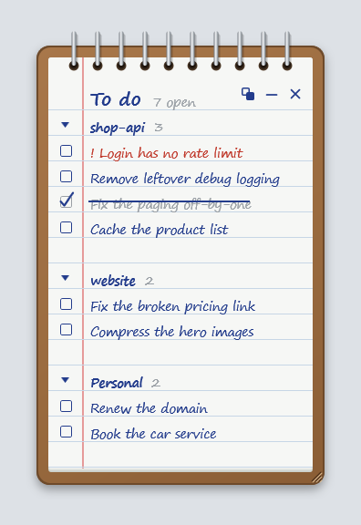

# AgentsToDo

One to-do list for you and your AI coding agents, always in view on your Windows desktop.
Your agents write the items. You see them on a spiral notepad and tick them off.



> **Built with AI.** This app was written by [Claude Code](https://claude.com/claude-code), Anthropic's AI coding assistant,
> and directed and tested by a person. It is shared as-is, in case it is useful to someone else.

## Why

A coding agent often finds a problem it should not fix right now: a missing check, a leftover debug line, a broken page in another module.
It mentions the problem in the chat, the chat ends, and the problem is forgotten.
Notes saved inside each project are not much better: you see them only when you open that project again.

AgentsToDo keeps all of these in one list that stays on your screen.

## How it works

- **The list is one Markdown file**, `todo.md` in your user folder. The desktop note shows it.
- **Agents add the items.** When an agent finds a problem it is not fixing, it adds a line under the project's heading.
- **Your own to-dos go through the agent too.** Tell it "add a to-do: renew the domain", and it writes the line.
- **You tick items on the note.** A tick writes `[x]` into the file, so the agents see what is done.

The note has no box for typing new items. That is on purpose: the agent does the writing, and you keep your eyes on the list.
A plain file is also the simplest thing any agent can write to: no account, no API, no login.
If you want to type an item yourself, open `todo.md` in any text editor. The note shows the change within a moment.

## Set up your agent

The agent needs two things: an instruction to use the file, and permission to edit it.

For [Claude Code](https://claude.com/claude-code), add these lines to `~/.claude/CLAUDE.md`:

```markdown
## To-do list
My to-do list is C:\Users\<you>\todo.md. It is shown on my desktop.
- When you find a problem you are not fixing now, add it to the list.
- When I ask you to add a to-do, add it to the list.
- Add each item under the project's `## ` heading (create the heading if it is missing),
  as `- [ ] <short title> <!-- details -->`. Start the title with `! ` for security problems.
- When an item is fixed, change its `[ ]` to `[x]`.
```

Then add this rule to `~/.claude/settings.json`, so it can edit the file without asking each time:

```json
{ "permissions": { "allow": ["Edit(~/todo.md)"] } }
```

Other agents work the same way.
Put the same lines in the file they read their instructions from, for example `AGENTS.md`.

## What the note does

- Shows the `- [ ]` items of the file, grouped by its `##` headings.
- Reloads as soon as the file changes on disk.
- Ticking a box writes `[x]` into that one line. The rest of the file stays exactly as it was.
- Double-click a line to select its text. All of it starts selected, so `Ctrl+C` copies the whole item, even the part cut off with "…". Press `Esc` or click elsewhere to finish.
- Drag it anywhere. It opens where you left it.
- Resize it with the ridges in the bottom-right corner. It keeps that size too.
- Four buttons: show or hide done items, keep it in front of other windows or behind them, minimize, and close.
  Done items are hidden at first. A group with only done items is hidden with them.
- Click a group heading to fold it. Folded groups stay folded after a restart.

## File format

The default file is `%USERPROFILE%\todo.md`. On first start the app creates it with a short example.

```markdown
# To do

## Website
- [ ] Fix the broken link
- [ ] ! Renew the certificate
- [x] Move the blog
- [ ] Compress the images <!-- Only the hero images. -->
```

- `# ...` (optional) is the title of the note.
- `## ...` starts a group.
- `- [ ]` is an open item, `- [x]` a done one (crossed out when done items are shown).
- A title that starts with `!` is written in red.
- Text inside `<!-- -->` is hidden on the note and shown in the tooltip when you hover the item.
- Every other line is ignored, so the file can hold other notes too.

Save the file as UTF-8.

## Settings

`%LOCALAPPDATA%\AgentsToDo\settings.json` keeps the position, size, front/behind mode, whether done items are shown, and folded groups.
To use another file, close the note, add `TodoFile`, and start it again:

```json
{ "TodoFile": "%OneDrive%\\Notes\\todo.md" }
```

## Install

You need Windows 10 or 11 and the [.NET 10 SDK](https://dotnet.microsoft.com/download) to build it.
Running it needs only the .NET 10 Desktop Runtime.

```powershell
git clone https://github.com/CanManalp/AgentsToDo.git
cd AgentsToDo
dotnet publish src/AgentsToDo -c Release -o "$env:LOCALAPPDATA\Programs\AgentsToDo"
```

Then start `%LOCALAPPDATA%\Programs\AgentsToDo\AgentsToDo.exe`.
To find it in the Start menu, put a shortcut to it in the Programs folder (press `Win+R` and type `shell:programs`).
To start it with Windows, put a shortcut to it in the Startup folder (press `Win+R` and type `shell:startup`).
To update, close the note first, then run the same `dotnet publish` command again.

## Good to know

- One note per Windows user. Starting the app a second time does nothing.
- In "behind" mode the note stays under all other windows but above the desktop.
  Click its taskbar button to bring it forward. It goes back when you click somewhere else.
  `Win+D` (show desktop) hides it like any other window.
- The note is made for the mouse. Its buttons and boxes don't take keyboard focus.

## License

[MIT](LICENSE)
